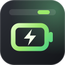
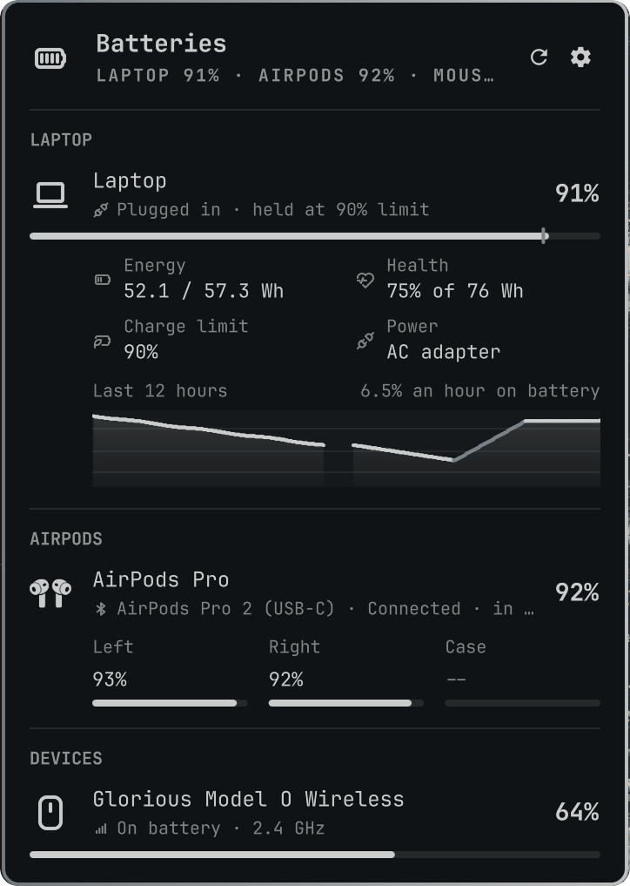

<div align="center">
  
  <h1>Batteries</h1>
  <p>Every battery in the Omarchy bar: the <b>laptop</b> with its draw, time left and health,<br/>
  <b>AirPods</b> bud by bud, and your <b>mouse, keyboard, headset, controller and phone</b>. Pick what the bar shows.</p>
  <p>
    
    
    
    <a href="https://github.com/T3lluz/omarchy-batteries/actions/workflows/ci.yml"></a>
    
  </p>
  <p><a href="#install"><b>Install</b></a> · <a href="#features">Features</a> · <a href="#supported-batteries">Supported batteries</a> · <a href="#settings">Settings</a> · <a href="#commands">Commands</a></p>
  
</div>

## Features

- **The bar shows what you pick:** laptop level, its charge or discharge rate in watts, time left or to full, AirPods (the emptier bud) and their case, any peripheral one toggle each, percentages on or off. A bolt shows while something charges.
- **Laptop:** level with the charge limit marked, the rate, energy in Wh, health against the design capacity, cycles, charge limit and power source.
- **Charge history:** the last 12 hours as a graph, plugged-in stretches in the accent colour, and your average drain on battery (time spent plugged in, even held at a charge limit, never counts as drain). It is kept for a day in `~/.local/state/omarchy-batteries/` and survives restarts.
- **AirPods:** each bud and the case with level, charging and in-ear state, or an AirPods Max's single battery. Last seen levels stay, dimmed, once they are back in the case.
- **JBL speakers:** their own section under the JBL mark, each titled with the mark and its model (Charge 5, Boombox 3, ...), the name you gave it in the JBL app underneath, with level and charging, read the way the JBL Portable app reads them.
- **Devices:** every peripheral with a level bar, its state and how it is connected (USB cable, 2.4 GHz or Bluetooth).
- **Live:** plugging a cable or the charger in or out refreshes within a second or two (it listens to udev), as does any change librepods reports for your AirPods.
- **Low battery:** one notification when a peripheral or your AirPods drop below the threshold. The laptop keeps Omarchy's own warning.
- **Updates from the panel:** Settings says when a new version is on GitHub and installs it with one click. Edits you made in the plugin folder are kept in `git stash`, not lost.
- **Every monitor agrees:** the bar draws the widget once per screen; they share one poller and read their settings straight from `shell.json`, so a choice made on one screen shows on all of them and survives a restart.
- Icons are [Tabler](https://tabler.io/icons) outlines drawn in your theme's colours, so they never depend on the Nerd Font build. The AirPods outline is the one from [omapods](https://github.com/thisisgm/omarchy-pods), picked by model.

## Install

```bash
omarchy plugin add https://github.com/T3lluz/omarchy-batteries.git --enable
```

Glorious and HyperX devices need read access to their HID node. Click the bar icon and press **Grant access** (it asks for your password once), or run:

```bash
sudo ~/.config/omarchy/plugins/io.github.t3lluz.batteries/bin/batteries install-udev
```

That installs `udev/70-omarchy-batteries.rules`, which gives the logged-in user (`uaccess`) access to those devices only. AirPods need the librepods daemon that [omapods](https://github.com/thisisgm/omarchy-pods) installs; nothing else is needed for them.

## Supported batteries

| Source | Batteries |
|---|---|
| sysfs + UPower | The laptop's own battery (two-battery laptops are combined) |
| librepods | AirPods, AirPods Pro and AirPods Max, through the daemon omapods installs |
| Built in, HID | Glorious Model O, O-, D and D- Wireless, on the cable (charging) and on the dongle |
| Built in, HID | HyperX Cloud Alpha Wireless |
| UPower | Bluetooth mice, keyboards and headsets, Logitech Lightspeed/Unifying (HID++), PlayStation and Switch controllers, Apple Magic devices, Wacom tablets, UPSes |
| openrazer | Razer wireless mice and keyboards, when the openrazer driver is installed |
| Built in, Bluetooth | JBL speakers the JBL Portable app reads, such as Charge 5 and Boombox 3 |
| HeadsetControl | SteelSeries, Logitech, Corsair, HyperX and other headsets, when `headsetcontrol` is installed |
| libimobiledevice | An iPhone or iPad on USB |
| KDE Connect | Phones paired with KDE Connect |

If one device is reported by two sources, the first in this table wins. The librepods reading of your AirPods beats BlueZ's single headset level.

The Glorious reader speaks the protocol from [korkje/mow](https://github.com/korkje/mow) and [gloriousctl](https://github.com/ibericode/gloriousctl), and the HyperX one the protocol from [streamdeck-hyperx-caw-battery](https://github.com/T3lluz/streamdeck-hyperx-caw-battery-Linux). It talks to `/dev/hidraw` through the kernel's ioctls directly, so it needs only Python's standard library. The JBL reader speaks the protocol mapped by [JBLControl](https://github.com/ffrafat/JBLControl), over the speaker's GATT service on the same Bluetooth link as the audio, so music keeps playing and nothing has to be paired twice.

## Use

| Input | Action |
|---|---|
| Click | Open the panel |
| Middle click | Refresh now |
| `r` in the panel | Refresh |
| `c` or `,` in the panel | Settings: what the bar shows, low battery |

## Settings

Pick them from the gear in the panel. They are saved in the widget's entry in `~/.config/omarchy/shell.json`:

| Key | Default | |
|---|---|---|
| `barLaptop` | `true` | Laptop level in the bar |
| `barLaptopRate` | `false` | Laptop charge or discharge rate (W) |
| `barLaptopTime` | `false` | Laptop time left or to full |
| `barAirpods` | `true` | AirPods, the emptier bud |
| `barAirpodsCase` | `false` | AirPods case |
| `barDevices` | `null` | Peripheral ids for the bar; `null` shows every mouse |
| `barPercent` | `true` | Percentages next to the icons |
| `lowThreshold` | `20` | Low battery level, in percent |
| `notifyLow` | `true` | Notify when a peripheral or AirPods cross it |
| `refreshIntervalSec` | `30` | Poll interval; 10 s with rate or time in the bar, 5 s while the panel is open |

## Commands

```bash
omarchy-shell io.github.t3lluz.batteries toggle     # open on the focused monitor; open | close
omarchy-shell io.github.t3lluz.batteries settings   # open on the settings view
omarchy-shell io.github.t3lluz.batteries refresh
omarchy-shell io.github.t3lluz.batteries status     # JSON: what the bar shows, every battery
```

The reader works on its own too:

```bash
bin/batteries list     # human readable
bin/batteries probe    # the JSON the widget reads
```

```
Laptop (BAT0)                      laptop      89%  discharging, 51.9 W, 1h 00m left, health 75%, limit 90%
AirPods Pro                        airpods     70%  L 80% R 70% case 50%⚡, connected
Glorious Model O Wireless          mouse       83% ⚡  charging, usb via glorious
```

## Development

```bash
node tests/model.test.js
python3 -B -m unittest discover tests
python3 scripts/fetch-icons.py    # refetch the Tabler icons, regenerate Icons.js
omarchy restart shell             # pick up QML changes
```

`Model.js` holds the pure logic and is tested under node; `bin/batteries` is the reader. See [AGENTS.md](AGENTS.md) for how the pieces fit.

## License

MIT. `AirPodsIcon.qml` is from omapods (MIT, © 2026 GM). Tabler Icons are MIT. Not affiliated with Apple, Glorious, HyperX, JBL or Razer.

One of a set of Omarchy plugins: **Batteries** · [ROG Deck](https://github.com/T3lluz/omarchy-rog-deck) · [Sonus](https://github.com/T3lluz/omarchy-sonus) · [Server Dashboard](https://github.com/T3lluz/omarchy-server-dashboard)
