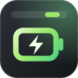
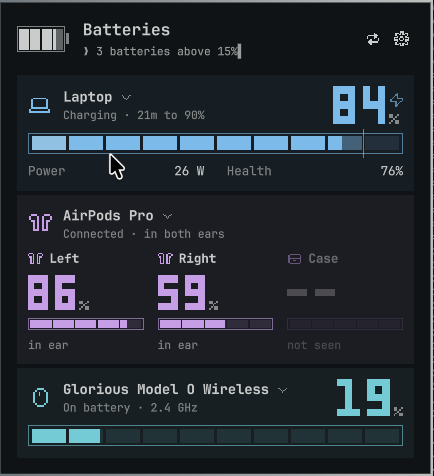

<div align="center">
  
  <h1>Batteries</h1>
  <p>Every battery in the Omarchy bar: the <b>laptop</b> with its draw, time left and health,<br/>
  <b>AirPods</b> bud by bud, and your <b>mouse, keyboard, headset, controller and phone</b>. Pick what the bar shows.</p>
  <p>
    
    
    
    <a href="https://github.com/T3lluz/omarchy-batteries/actions/workflows/ci.yml"></a>
    
  </p>
  <p><a href="#install"><b>Install</b></a> · <a href="#features">Features</a> · <a href="#supported-batteries">Supported batteries</a> · <a href="#settings">Settings</a> · <a href="#commands">Commands</a></p>
  
</div>

## Features

- **The bar shows what you pick:** laptop level, its charge or discharge rate in watts, time left or to full, AirPods (the emptier bud) and their case, any peripheral one toggle each, percentages on or off. It writes them in the panel's pixel figures beside pixel icons, in the bar's own colours. While something is on a charger, a dark band steps up through its icon every few seconds, like charge flowing in. It keeps going when the battery is full or held at a limit, so you can see the charger is connected.
- **Hover the bar item** for a card with every battery on a line: its icon, a small battery and the level, with a bolt in the corner while it charges.
- **A room per battery:** every battery gets its own tile in a colour from your theme's palette (the laptop blue, audio magenta, mice and keyboards cyan, controllers green, phones yellow), led by its level in big block digits over a battery split into ten cells, a tenth each. Low turns the room your theme's urgent colour and adds a mark, so it reads without colour too.
- **Alive, not busy:** when the panel opens, the rooms rise in one after another, each battery fills from empty while its number counts up, readings decode in like a terminal (only then: a reading that changes later just changes), and each icon acts itself out once, in whole pixels (the laptop hops, a mouse wiggles, AirPods sway, a phone buzzes). While something charges, a pulse runs through its cells, the cell it is filling breathes and so does the bolt. Point at a battery and its cells give under the pointer. Nothing moves with reduced motion on.
- **Click a room to open it:** its other readings (how a device is connected, what reads it, the laptop's limit, cycles and energy) and switches for what of it the bar shows, right there. One room is open at a time; click again to close it.
- **Laptop:** its level and what it is doing, the charge limit as a tick across its battery, then the power in or out, health against the design capacity, the limit, cycles and energy in Wh. A bolt means charge is flowing in, a plug means it is on a charger with nothing flowing. Same for everything else in the panel.
- **Drain:** your average drain on battery over the last 12 hours, listed with the laptop. Time spent plugged in, even held at a charge limit, never counts. The charge history behind it is kept for a day in `~/.local/state/omarchy-batteries/` and survives restarts.
- **AirPods:** left, right and case side by side, each with its level in the same block digits, a small battery and what it is doing (in ear, out, charging), or an AirPods Max's single battery. A closed case takes the buds in it off the air, so with one bud in your ear and the other in the case, the case and that bud keep their last levels, dimmed and marked "in case · 14m ago". Those levels are kept on disk and survive a restart. Like any other device, AirPods leave the panel when they disconnect.
- **JBL speakers:** first among the devices under the JBL mark, each titled with its model (Charge 5, Boombox 3, ...), the name you gave it in the JBL app underneath, with level and charging, read the way the JBL Portable app reads them.
- **Devices:** one room per peripheral (mouse, keyboard, speaker, headphones, controller, phone, tablet and more), with its level, its battery, its state and how it is connected (USB cable, 2.4 GHz or Bluetooth).
- **At a glance:** the prompt line under the panel's title types out what is worth knowing, like how long the laptop has left and which battery is lowest, and takes turns between them. Anything low holds that line still.
- **Live:** plugging a cable or the charger in or out refreshes within a second or two (it listens to udev), as does any change librepods reports for your AirPods.
- **Low battery:** one notification when a peripheral or your AirPods drop below the threshold, with a pixel badge of the device and its battery. Click it to open the panel. Plug the device in and the same notification says thanks and goes. The laptop keeps Omarchy's own warning.
- **Updates from the panel:** Settings says when a new version is on GitHub and installs it with one click. Edits you made in the plugin folder are kept in `git stash`, not lost.
- **Every monitor agrees:** the bar draws the widget once per screen; they share one poller and read their settings straight from `shell.json`, so a choice made on one screen shows on all of them and survives a restart.
- Every icon, in the bar and the panel, is pixel art from one set, [Pixelarticons](https://pixelarticons.com), with AirPods and their case drawn to match. Icons and figures are drawn on whole screen pixels, never scaled, so they stay sharp at any display scale. The rooms take colours from your theme (or, where its palette is greys, each kind's own soft hue); the bar keeps the bar's colours.

## Install

```bash
omarchy plugin add https://github.com/T3lluz/omarchy-batteries.git --enable
```

Glorious and HyperX devices need read access to their HID node. Click the bar icon and press **Grant access** (it asks for your password once), or run:

```bash
sudo ~/.config/omarchy/plugins/io.github.t3lluz.batteries/bin/batteries install-udev
```

That installs `udev/70-omarchy-batteries.rules`, which gives the logged-in user (`uaccess`) access to those devices only. AirPods need the librepods daemon that [omapods](https://github.com/thisisgm/omarchy-pods) installs; nothing else is needed for them.

## Supported batteries

| Source | Batteries |
|---|---|
| sysfs + UPower | The laptop's own battery (two-battery laptops are combined) |
| librepods | AirPods, AirPods Pro and AirPods Max, through the daemon omapods installs |
| Built in, HID | Glorious Model O, O-, D and D- Wireless, on the cable (charging) and on the dongle |
| Built in, HID | HyperX Cloud Alpha Wireless |
| UPower | Bluetooth mice, keyboards and headsets, Logitech Lightspeed/Unifying (HID++), PlayStation and Switch controllers, Apple Magic devices, Wacom tablets, UPSes |
| openrazer | Razer wireless mice and keyboards, when the openrazer driver is installed |
| Built in, Bluetooth | JBL speakers the JBL Portable app reads, such as Charge 5 and Boombox 3 |
| HeadsetControl | SteelSeries, Logitech, Corsair, HyperX and other headsets, when `headsetcontrol` is installed |
| libimobiledevice | An iPhone or iPad on USB |
| KDE Connect | Phones paired with KDE Connect |

If one device is reported by two sources, the first in this table wins. The librepods reading of your AirPods beats BlueZ's single headset level.

The Glorious reader speaks the protocol from [korkje/mow](https://github.com/korkje/mow) and [gloriousctl](https://github.com/ibericode/gloriousctl), and the HyperX one the protocol from [streamdeck-hyperx-caw-battery](https://github.com/T3lluz/streamdeck-hyperx-caw-battery-Linux). It talks to `/dev/hidraw` through the kernel's ioctls directly, so it needs only Python's standard library. The JBL reader speaks the protocol mapped by [JBLControl](https://github.com/ffrafat/JBLControl), over the speaker's GATT service on the same Bluetooth link as the audio, so music keeps playing and nothing has to be paired twice.

## Use

| Input | Action |
|---|---|
| Click | Open the panel |
| Middle click | Refresh now |
| `r` in the panel | Refresh |
| `c` or `,` in the panel | Settings: what the bar shows, low battery |

## Settings

Pick them from the gear in the panel. They are saved in the widget's entry in `~/.config/omarchy/shell.json`:

| Key | Default | |
|---|---|---|
| `barLaptop` | `true` | Laptop level in the bar |
| `barLaptopRate` | `false` | Laptop charge or discharge rate (W) |
| `barLaptopTime` | `false` | Laptop time left or to full |
| `barAirpods` | `true` | AirPods, the emptier bud |
| `barAirpodsCase` | `false` | AirPods case |
| `barDevices` | `null` | Peripheral ids for the bar; `null` shows every mouse |
| `barPercent` | `true` | Percentages next to the icons |
| `lowThreshold` | `20` | Low battery level, in percent |
| `notifyLow` | `true` | Notify when a peripheral or AirPods cross it |
| `refreshIntervalSec` | `30` | Poll interval; 10 s with rate or time in the bar, 5 s while the panel is open |

## Commands

```bash
omarchy-shell io.github.t3lluz.batteries toggle     # open on the focused monitor; open | close
omarchy-shell io.github.t3lluz.batteries settings   # open on the settings view
omarchy-shell io.github.t3lluz.batteries refresh
omarchy-shell io.github.t3lluz.batteries status     # JSON: what the bar shows, every battery
```

The reader works on its own too:

```bash
bin/batteries list     # human readable
bin/batteries probe    # the JSON the widget reads
```

```
Laptop (BAT0)                      laptop      89%  discharging, 51.9 W, 1h 00m left, health 75%, limit 90%
AirPods Pro                        airpods     70%  L 80% R 70% case 50%⚡, connected
Glorious Model O Wireless          mouse       83% ⚡  charging, usb via glorious
```

## Development

```bash
node tests/model.test.js
python3 -B -m unittest discover tests
python3 scripts/fetch-pixel-icons.py    # refetch the pixel icons, regenerate Pixels.js
omarchy restart shell             # pick up QML changes
```

`Model.js` holds the pure logic and is tested under node; `bin/batteries` is the reader. See [AGENTS.md](AGENTS.md) for how the pieces fit.

## License

MIT. The icons are from Pixelarticons (MIT). The text face is [Monocraft](https://github.com/IdreesInc/Monocraft) by Idrees Hassan, bundled under the SIL Open Font License 1.1 (`assets/fonts/OFL.txt`). Not affiliated with Apple, Glorious, HyperX, JBL or Razer.

One of a set of Omarchy plugins: **Batteries** · [ROG Deck](https://github.com/T3lluz/omarchy-rog-deck) · [Sonus](https://github.com/T3lluz/omarchy-sonus) · [Server Dashboard](https://github.com/T3lluz/omarchy-server-dashboard)
